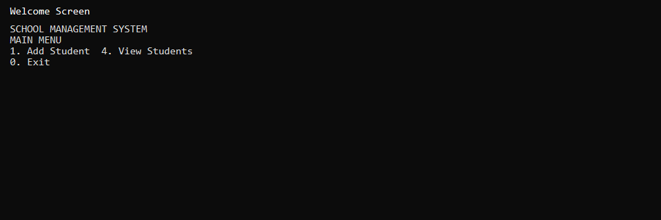
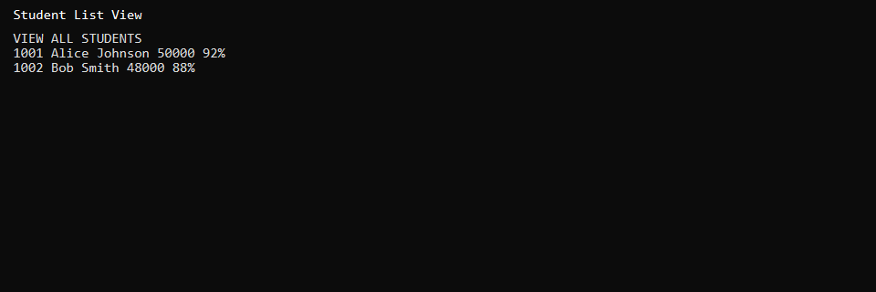
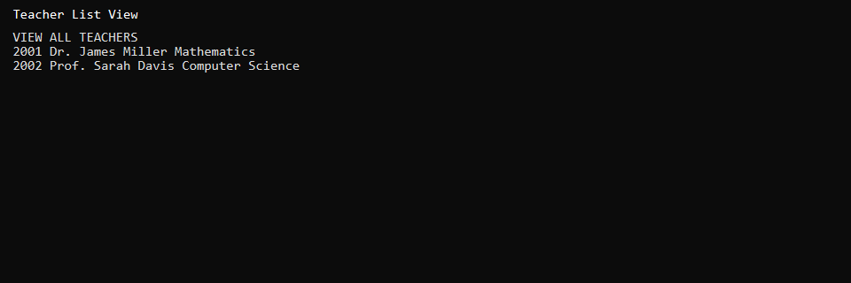

# School Management System (C++)

Windows console application for managing students, teachers, and subject assignments using **singly linked lists** with CSV file persistence.

## Features

- Add, view, search, and delete students
- Teacher management and subject assignment
- Colored console UI (Windows API)
- Auto-save/load from CSV files (`students.txt`, `teachers.txt`)

## Tech Stack

- C++17
- Singly linked lists for all entities
- File I/O with `<fstream>`
- Windows API (`windows.h`) for console colors
- Visual Studio 2022 (v143 toolset, x64)

## Platform

**Windows only** — uses `windows.h` for console styling and `system("cls")`.

## Screenshots







## Build and Run

1. Open `School Management System.sln` in Visual Studio 2022
2. Set configuration to **Debug | x64**
3. Copy sample data files before first run:

```powershell
copy "School Management System\students.sample.txt" "School Management System\students.txt"
copy "School Management System\teachers.sample.txt" "School Management System\teachers.txt"
```

4. Build and run (F5)

## Data Files

| File | Purpose |
|------|---------|
| `students.sample.txt` | Example student records (committed) |
| `teachers.sample.txt` | Example teacher records (committed) |
| `students.txt` | Runtime data (gitignored) |
| `teachers.txt` | Runtime data (gitignored) |

CSV format: `name,id,fee,attendance` for students; `name,id,subject` for teachers.

## Project Structure

```
School Management System/
├── School Management System/
│   ├── School Management System.cpp
│   ├── students.sample.txt
│   └── teachers.sample.txt
└── School Management System.sln
```

## Author

Muhammad Afzal Kalwar — [GitHub](https://github.com/mafzalkalwardev)

## License

MIT — see [LICENSE](LICENSE).
